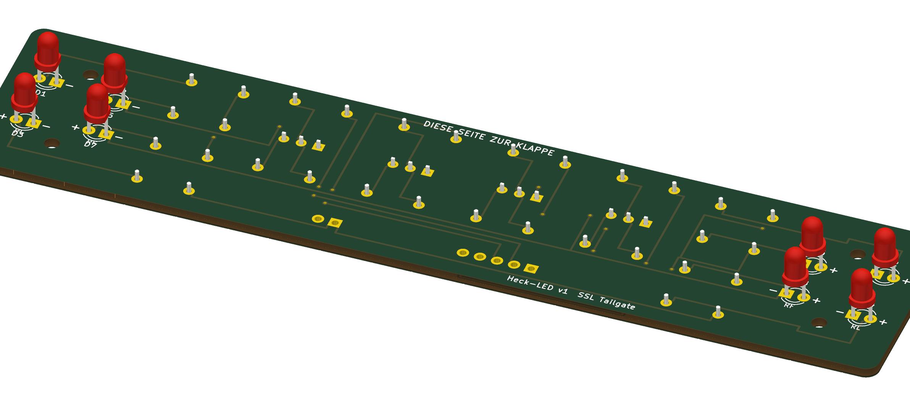

# Tail Light PCB for the AN3DRC Skid Steer Loader

PCB for working tail, brake and reverse lights in the tailgate of the
[AN3DRC 3D-printed RC Tracked Skid Steer Loader](https://cults3d.com/de/modell-3d/spiel/3d-printed-rc-tracked-skid-steer-loader-in-1-8-5-scale-by-an3drc-an3drc_construction).

**Print files (tailgate frame, bezel, LED housings, lenses) and assembly: [MakerWorld](https://makerworld.com/de/collections/37654355-bobcat-an3drc-skid-steer)**

Board: 134 × 30 mm, 2 layers, 1.6 mm. 8 LEDs (3 mm) on the front facing the tailgate, all
other parts on the back. 4 mounting holes 2.2 mm (M2 or 2.2 mm self-tapping screws, max. 5 mm long).
Driven by a Pro Micro: 4 channels, each pin HIGH switches its two LEDs on through a low-side
MOSFET. The LEDs run from the 12 V battery (3S LiPo).

## Download

Ready-to-upload Gerber ZIPs are attached to the [latest release](../../releases/latest).

## Two versions, same circuit and outline

| Folder | Version |
|---|---|
| [`1_THT_hand_soldered`](1_THT_hand_soldered) | Through-hole, solder it yourself. Upload `Heck_LED_THT_Gerber.zip` unchanged to any PCB maker (JLCPCB, PCBWay, Aisler, ...), default settings: 2 layers, 1.6 mm. `BOM.csv` = parts list (BS170 in TO-92, 1/4 W resistors). |
| [`2_SMD_factory_assembled`](2_SMD_factory_assembled) | SMD parts on the back, assembled by JLCPCB. Upload `Heck_LED_SMD_Gerber.zip`, enable "PCB Assembly", assembly side **Bottom**, upload `JLCPCB_BOM.csv` and `JLCPCB_CPL.csv` (all parts are basic parts with LCSC numbers). Check the SOT-23 rotation in the preview. `pick_and_place_generic.csv` is for other assembly services. You still hand-solder the 8 LEDs and the 2 connectors. |
| [`3_KiCad_source`](3_KiCad_source) | KiCad 10 projects of both versions. |

`Schematic.pdf` is drawn for the THT version. The SMD version is identical except BS170 → 2N7002 and SMD resistors.

## Channels (left + right side each)

| Channel | Position | Function | LED | Resistor |
|---|---|---|---|---|
| K1 | outer top | tail light | red | 1.5 k |
| K2 | outer bottom | tail light | red | 1.5 k |
| K3 | inner top | brake light | red | 680 |
| K4 | inner bottom | reverse light | white | 1 k |

R9–R12 = gate resistors (1 k), R13–R16 = 100 k pulldowns.

## Connectors

Straight magnetic pogo connectors, 2.5 mm pitch, 0.7 mm pins (e.g. AliExpress "5Pin 2.5mm" / "2Pin 2.5mm").
No 90° types, no 2.8 mm pitch.

- **J1** (5 pins, "PRO MICRO"): GND, K1, K2, K3, K4 (5 V signals)
- **J2** (2 pins, "AKKU 12V"): pin 1 = +, pin 2 = −

Battery minus and Pro Micro GND must be connected.

LED marking: `+` = anode (outer, long leg), `−` = cathode (inner, square pad, flat side).

## Parts per tailgate

| Part | Qty |
|---|---|
| LED 3 mm red, high brightness | 6 |
| LED 3 mm white, high brightness | 2 |
| Magnetic pogo connector 5-pin + 2-pin, straight, 2.5 mm | 1 set each |
| Screws M2 × 5 or 2.2 × 4.5 self-tapping | 4 |
| THT only: BS170 (TO-92, **not** 2N7000) | 4 |
| THT only: resistors 1/4 W: 1.5 k ×4, 680 ×2, 1 k ×6, 100 k ×4 | |

DRC: 0 unconnected pads. The remaining warnings are silkscreen overlaps only.
